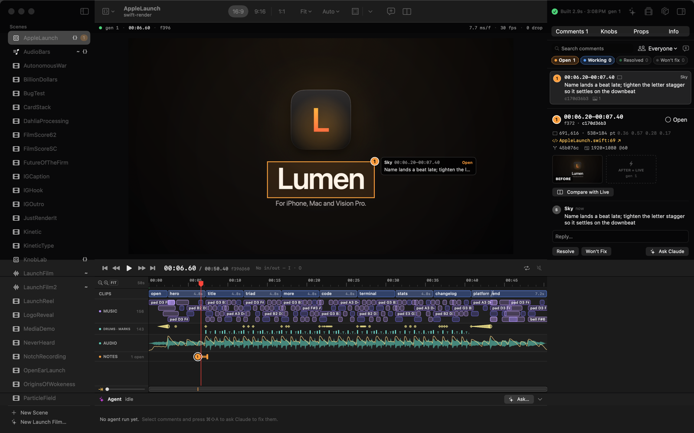

# swift-render Studio

Studio is the native macOS editor for swift-render projects. You open a package, pick a scene,
and watch it play. Edits to the scene's Swift code hot-reload in about 2 s. You can scrub the
timeline that the engine probed from your `Timeline`/`Score`, tune knobs, leave timecoded comments
with an optional region box, hand open comments to Claude Code, and export deliverables. All of
this runs your own code: Studio builds the project's CLI and talks to it. It never interprets
your scenes itself.



*This screenshot was made with `swift run swift-render-studio . --scene AppleLaunch --at 6.6 --wait-audio --comment first --snapshot out/studio.png`,
after one `swift-render review add AppleLaunch --at 6.2 --end 7.4 --region 0.36,0.57,0.28,0.17 "…"`.*

```
swift run swift-render-studio .                        # this repo, Welcome → project window
swift run swift-render-studio path/to/MyApp/Launch     # any package whose CLI links SwiftRenderTool
open "out/Studio/swift-render Studio.app"              # the packaged app (scripts/package-studio.sh)
```

Requires macOS 14+ and a Swift 6 toolchain (Xcode 26) on the machine, because Studio compiles
your project.

## How it works

```
 Studio (SwiftUI, Foundation + SwiftRenderKit only)
   ├─ FileWatcher  Sources/ Plugins/ Package.swift(.resolved) swift-render.json assets/ .swift-render/{reviews,knobs}
   ├─ BuildController   swift build --product <p> --scratch-path .build/studio   (one at a time)
   ├─ HostSupervisor    <p> serve  ← JSON lines + binary BGRA frames on stdio   (blue/green swap per build)
   ├─ PlaybackEngine    stream/credit playback, frame cache, scrub, sharpen-on-pause, audio
   ├─ ReviewController  .swift-render/reviews/<Scene>.json via ReviewStore (flock, atomic)
   ├─ AgentController   claude -p --agent swift-render-director … (stream-json)
   └─ RenderQueue       <p> render <Scene> … --progress json   (exports, one at a time)
```

- **The project** is the nearest ancestor with `swift-render.json`, or else the nearest with
  `Package.swift`. `swift-render.json`'s `product` names the CLI (default `swift-render`).
- **Builds** use the scratch path `.build/studio`. This keeps Studio off the lock that your
  terminal's `swift build` holds. A change that lands mid-build queues exactly one more build.
  A failed build keeps the last good host running and shows the errors over the viewer;
  click an error to open the file at that line.
- **What the watcher acts on.** Files under `Sources/` and `Plugins/`, plus `Package.swift`,
  `Package.resolved` and `swift-render.json`, trigger a rebuild; `assets/` reopens the scene on
  the running host; `.swift-render/reviews` and `.swift-render/knobs` reload threads and knobs
  without a build. Swift files elsewhere
  (`Tests/`, `scripts/`), `.build`, `.git`, `.swiftpm` and `node_modules` at any depth, and hidden
  top-level folders other than `.swift-render` (such as `.claude/` worktrees) are ignored.
- **The render host** is your CLI running `serve`. Every successful build starts a new host,
  warms it on the current frame, and then swaps it in, so the viewer never shows a blank frame.
  Starts, swaps, crash restarts and shutdown run one at a time: a host that is no longer wanted
  (a newer build is waiting, or the window closed) shuts itself down instead of going live, so an
  older build never replaces a newer one and no `serve` process is left without an owner. A scene,
  aspect, knob or props change made during a swap is replayed on the new host before it goes live.
- **Crashes.** If a host crashes, Studio shows a crash card with the stderr tail and restarts it.
  The card's time and the frames playback skips come from the host's own crash message (the
  frame that actually crashed), not the playhead, and a playback stream stops just before that
  frame. Skipped frames belong to the scene that crashed: the same frame of another scene still
  renders. A scene opened onto a skipped frame shows the nearest frame that didn't crash instead
  of waiting for one that never comes. The next build that goes live clears the card, the skipped
  frames and the restart budget.

## The window

```
┌ scene ▾ │ 16:9 · 9:16 · 1:1 │ Fit ▾ │ Auto ▾ │ Guides │ A/B │ ● Built 1.3s │ ✦ │ Render │ ◔ │ ▤ ┐
│ SCENES        │                VIEWER                           │ Comments Knobs Props Info  │
│ REVIEW        │                                                 │                            │
│ RENDERS       │  ▶ 00:03.00 / 00:09.90  f180@60   I→O           │                            │
│               │ RULER · CLIPS · SCORE LANES · AUDIO · NOTES      │                            │
│ + New Scene   │ ✦ Agent · idle                                  │                            │
└───────────────┴─────────────────────────────────────────────────┴────────────────────────────┘
```

- **Sidebar.** Lists scenes (with `~` for audio-reactive scenes, `{}` for props scenes, and an
  open-comment badge), review counts, and recent renders. Everything in the window has a
  right-click menu; see [Right-click menus, Delete and Undo](#right-click-menus-delete-and-undo).
- **Viewer.** Aspect canvas (16:9, 9:16, 1:1), zoom, title/action-safe guides, region tool for
  comments, comment pins, and A/B compare. A comment's region pin is drawn only on a canvas of the
  same shape as the one it was made on (a 9:16 note is hidden at 16:9; its thread still lists it).
- **Timeline.** The ruler, then the clips the engine probed (nested rows; each clip links to its
  `file:line`), score lanes by kind, the loudness envelope, and comment markers.
- **Inspector.** Comments (filter, thread, resolve), Knobs (`Knob.double/bool/text/color`, live,
  with Save writing `.swift-render/knobs/<Scene>.json`), Content (the props of a data-driven scene;
  `--tab props`), and Info (canvas, structure, host pid/generation).
- **Agent panel.** Shows the live transcript of a headless Claude Code run working through your
  comments (see [review-loop.md](review-loop.md) and [Agent runs and Revert Run](#agent-runs-and-revert-run)).

### Keys

Help › Keyboard Shortcuts (⇧⌘/) shows the same list in the app.

| Key | Action | Key | Action |
|---|---|---|---|
| Space | play / pause | J K L | play backward, stop, play forward (hold K + J/L = frame step) |
| ← → | one frame (⇧: one second) | ↑ ↓ | previous / next edit |
| Home / End | start / end | Esc | cancel the region tool, a draft comment or compare |
| I / O | set in / out (⇧: go to) | ⌥X | clear in/out |
| / | loop in→out | C | comment at playhead (range when in/out set) |
| R | mark a region (or hold ⌥ and drag) | [ ] | previous / next comment |
| \\ | A/B compare (\| cycles the mode) | G | next guide |
| ⇧Z | zoom the timeline to fit | ⌘= / ⌘− | zoom the timeline in / out |
| ⌘↩ | post a comment | ⇧⌘↩ | post and ask Claude |
| ⌘B | rebuild now | ⌘. | stop (agent, build, then render) |
| ⌘R | export again with the last preset | ⇧⌘R | Export… sheet |
| ⇧⌘A | Ask Claude… | ⌥⌘J | show / hide the Claude panel |
| ⇧⌘O | open scene / clip source | ⌘O | open project… |
| ⌘1–4 | Comments, Knobs, Content, Info | ⌥⌘I / ⌥⌘S | inspector / scenes sidebar |
| ⌫ | delete the selected comment (asks first) | ⌘Z / ⇧⌘Z | undo / redo a delete or Trash move |
| ⌘C | copy the selected comment's text (Edit › Copy) | ⇧⌘0 | Welcome window |

### Menus

| Menu | Commands |
|---|---|
| File | Open Project… (⌘O), Welcome Window (⇧⌘0) |
| Playback | Play or Pause, Play Forward, Play Backward, Next/Previous Frame, Next/Previous Edit, Set In, Set Out, Clear Range, Loop Range |
| Comments | New Comment at Playhead, Mark a Spot on the Frame, Next/Previous Comment, Compare Before and After |
| Build | Rebuild Now (⌘B), Stop (⌘.), Open Scene Source (⇧⌘O) |
| Claude | Ask Claude… (⇧⌘A), Show/Hide Claude Panel (⌥⌘J) |
| Export | Export Again (⌘R), Export… (⇧⌘R) |
| View | Show or Hide Scenes, Show or Hide Inspector, the four inspector tabs, Zoom Timeline In/Out/to Fit, Next Guide, Appearance (and Show Playback Statistics in debug builds) |
| Help | Keyboard Shortcuts (⇧⌘/) |

Studio handles unmodified keys itself, never as menu shortcuts. They pass straight through
while you type in a text field, so typing "jkl" in a comment never moves the playhead.

## Right-click menus, Delete and Undo

Every element has a standard Mac context menu. The same thing gets the same menu wherever it
appears: a comment's list row, its pin on the viewer, its marker in the Comments lane and its
thread header all use one builder (`ContextMenus.comment`). Every menu's commands are also
VoiceOver actions on the element (VO-⌘-Space).

| Right-click | Menu (separators as —) |
|---|---|
| Comment (row, pin, lane marker, thread header) | Reply · Jump to 0:06.20 · Compare Before and After — Mark Done · Won't Fix (or Looks Good · Not Quite, or Reopen) · Ask Claude… — Open File.swift:73 · Copy Text ⌘C · Copy Reference — Delete Comment… ⌫ |
| A message in a thread | Copy — Delete Reply… (only replies a person wrote; Claude's and Studio's notes stay) |
| Scene in the sidebar | Open · Open in Xcode (your editor from Settings) · Show in Finder — Copy Name · Duplicate — Move to Trash… |
| Sidebar section header | Collapse All · Expand All |
| Export (sidebar or a finished row in the Exports popover) | Open · Show in Finder — Copy Path — Move to Trash… |
| Clip on the timeline | Jump to Start · Select Range (In/Out) · Comment on This Clip… — Open File.swift:42 · Copy Timecode |
| Score event or caption | Comment on This Range… · Select Range · Copy Timecode |
| Ruler or an empty lane | Add Comment Here — Set In Here · Set Out Here · Clear In and Out — Zoom to Fit · Follow Playhead |
| The picture | Add Comment Here (a point pin where you clicked) — Copy Frame · Save Frame As… — Fit · Actual Size — Show Safe Areas |
| Knob | Reset to Default · Copy Value — Open File.swift:12 |
| Content field | Revert Field · Copy Value — Open Scene Source — Remove Item (list items) |
| Claude transcript row / changed file | Copy — Open File.swift · Show in Finder (· Copy Path) |

- **Copy Reference** puts `AppleLaunch @ 0:06.20 (c49807dc8)` on the clipboard: the scene, the
  time and the comment id that `swift-render review show <id>` and the MCP tools accept.
- **Copy Frame / Save Frame As…** ask the running host for a full-resolution PNG (`still`) of
  the frame at the playhead; they're dimmed while there is no preview.
- **Duplicate** writes `<Scene>Copy.swift` next to the original with every whole-word use of
  the scene's name renamed, and the copy appears after the next build. It refuses (and says
  why) when the file declares anything else at the top level that isn't `private` or
  `fileprivate`, because the copy would clash with the original. Undo moves the copy to the Trash.

**Data safety.** Every destructive command asks first in one confirmation dialog that names
exactly what goes, with a red destructive button and Cancel as the default:

- **Delete Comment…** removes the comment and its attachment frames through `ReviewStore`
  (`remove(scene:id:)`, locked and atomic like every review edit). **Delete Reply…** removes one
  reply and the frames only it used.
- **Move to Trash…** (scenes and exports) uses `FileManager.trashItem`, never `rm`. Studio only
  moves a plain file strictly inside the project: symlinked folders are resolved first, a
  symlink itself, a folder, `..` and anything in a hidden folder (`.git`, `.build`, `.swiftpm`)
  are refused, scenes must be `.swift` files under `Sources/`, and exports must be in `out/`.
  A trashed scene disappears after the rebuild; its comments and knobs stay in `.swift-render`.
- **Undo.** Edit › Undo (⌘Z) reverses each of these: a comment or reply comes back with its
  attachment files (never over a file that has reappeared), and a trashed file is moved back
  from the Trash (never over a file now at its path; then it stays in the Trash and Studio says
  so). Redo (⇧⌘Z) does it again. The undo stack is the window's, shared with text fields.

**Keys and the Edit menu.** ⌫ (or Edit › Delete) asks to delete the selected comment;
⌘C (Edit › Copy) copies its text. Both go through the responder chain: while you type in a
field, ⌫ and ⌘C act on the text as usual, and only when nothing in front handles them does
Studio's `EditResponder` (after the window) act on the comment. Shortcut glyphs in context
menus are hints only; no menu adds a second key binding.

**For agents.** The menus are data: `ContextMenus.<thing>(…)` returns `[StudioMenuEntry]`, which
`StudioMenuContent` draws as menu items, `studioContextMenu(_:)` attaches (with the VoiceOver
actions), and `MenuPreview` draws for snapshots. To add a command, add it to the builder; every
surface that shows that thing picks it up. Deletes go through `model.edits` (`EditController`):
call `request(_:)` to ask first, never delete directly from a view.

```
swift run swift-render-studio . --scene AppleLaunch --comment first --context-menu comment --snapshot out/menu.png
swift run swift-render-studio . --scene AppleLaunch --comment first --confirm delete-comment --snapshot out/confirm.png
```

`--context-menu comment|reply|scene|section|export|clip|time|frame|knob|content|transcript`
draws that menu (for the selected comment, else comment #1; the open scene; the newest export;
the selected clip, else the first; the playhead's time) where it would open, and prints its
outline (`Reply | Jump to 0:06.20 | … | — | Delete Comment… ⌫`). `--context-menu-at x,y` moves it
(window points from the top-left). `--confirm delete-comment|delete-reply|trash-scene|trash-export`
raises the real confirmation dialog and prints its title, button and message. Snapshots never
delete anything: the snapshot window takes no input.

## Rendering

Exports run through your project's CLI, the same `render` command you would type, with
`--progress json` added. The preview host is never used for exports. Jobs run one at a time;
press ⇧⌘R for the sheet, and ⌘R to render again with the last preset (it is remembered
across launches).

Exports use a **release** build of the CLI by default ("Final" in the sheet): `swift build -c
release --product <p> --scratch-path .build/studio-release`, built once and reused until a file
under `Sources/` or `Plugins/`, the manifest, or a local `.package(path:)` dependency is newer than
the moment the last successful build *started* (`.build/studio-release/studio-export.stamp`), so an
edit saved mid-build still triggers a rebuild. It has its own scratch path so it never waits on the
live debug builds. Debug builds are 6–20× slower at score synthesis and heavy scenes. A whole film
of 8 s or more renders with `--jobs auto` (parallel processes, stitched without re-encoding; the
driver sums its parts' progress into one stream and, on Stop, stops them and deletes their scratch
files); shorter films and In→Out ranges render in one process. The time left follows the speed of
the last few seconds. "Quick" uses the debug executable the preview host runs.

The Exports popover shows one line of status per job: "Building for export…", "Preparing
music…" (the CLI's `{"stage":"audio"}` line), "Rendering 120 of 900 · 42 fps · about 18 s
left" under a native progress bar, "Finishing up…" (`{"stage":"mux"}`), then Open and Show in
Finder. Snapshots: `--render <preset> [--render-wait done] [--render-build quick] --show renders`
prints the job's final state and wall time.

| Preset | Output | Flags passed to `render` |
|---|---|---|
| Master 1080p60 | 1920×1080, 60 fps, H.264 12 Mb/s | `--fps 60` |
| 4K UHD | 3840×2160, 60 fps, H.264 35 Mb/s | `--fps 60 --scale 2` (Recorder encodes `size × scale`) |
| Vertical 9:16 | 1080×1920, 60 fps | `--fps 60 --aspect 9:16` |
| Square 1:1 | 1080×1080, 60 fps | `--fps 60 --aspect 1:1` |
| App Preview Portrait | 886×1920, 30 fps | `--fps 30 --width 886 --height 1920` |
| App Preview Landscape | 1920×886, 30 fps | `--fps 30 --width 1920 --height 886` |
| Preview | 960×540, 30 fps | `--preview` |
| GIF | 720×405, 15 fps, looping | `--fps 15 --scale 0.5 --no-postfx`, then an ffmpeg palette pass |

The sheet also lets you set:

- **Range.** Choose the whole scene or In→Out. The CLI skips the audio mux for ranges, so when
  `ffmpeg` is installed, Studio exports the score with `<p> audio` and muxes in the matching
  slice (AAC 256 kb/s). Without ffmpeg, a range export is silent and the sheet says so.
- **Build.** *Final* (the default for every preset) uses the release CLI in
  `.build/studio-release` described above. The first Final export compiles the whole package;
  later ones start at once unless sources changed. *Quick* starts right away with the debug
  binary the viewer is running.
- **Knobs.** When the live values differ from `.swift-render/knobs/<Scene>.json`, you choose
  between rendering the live values (snapshotted to a file and passed as `--knobs`) and saving
  them to the file first. Live props are passed as `--props`. Both are snapshotted when you
  queue the job, so moving a slider during an export doesn't change it.
- **Output.** The default is `out/<Scene>-<preset>-<yyyyMMdd-HHmm>.mp4|gif`; **Change…** picks
  another path. When a preset change swaps the extension of a custom output, the sheet picks an
  unused name (e.g. `demo-2.gif`) instead of overwriting.

The render, GIF encode and audio mux write a hidden `.<name>.<tag>.partial.<ext>` file next to
the destination, which replaces the destination only when the job succeeds. A failed build, a
failed render or a Stop removes only that partial file, so an export never deletes a file you
chose to replace. Partial files are not listed under recent renders.

The sheet refuses to start a job that can't succeed:

- **App Store previews** must be 15–30 s, which App Store Connect enforces. A longer scene needs
  an In→Out range within that window, and the preset tiles stay dimmed until one exists.
- **GIF** needs `ffmpeg` on the login-shell PATH (`brew install ffmpeg`).
- App Store presets warn when the export will have no audio track (a silent scene, or an In→Out
  range without ffmpeg).
- Presets that change the aspect (9:16, 1:1, the App Store sizes) warn that the scene was
  authored at 16:9 and offer **Preview 9:16 / 1:1** to check the layout in the viewer first.
  A scene that reads `renderContext.size` adapts; one with fixed 16:9 positions will not.

**Activity.** The toolbar button shows a progress ring while a job runs. Its popover lists
every job:

- running: a progress bar, `done/total`, encode fps and ETA, plus a stop button
- failed: the CLI's error line, with the tail of its output in the tooltip
- finished: **Reveal in Finder**, **Open**, and **Attach to Comment**. Attach replies to an
  open comment on that scene with a `.video` attachment (a project-relative path such as
  `out/Hero-1080p60-….mp4`), so the reviewer and the agent can see what was delivered.

Stop (■ or ⌘.) sends SIGINT, then SIGTERM after 2 s, then SIGKILL, and deletes the partial
file. Closing the window or quitting Studio stops the running export the same way, so no
render outlives the app.

## Command line and snapshots

```
swift-render-studio [project | --project dir] [--scene X] [--at t] [--tab comments|knobs|props|info]
                    [--appearance light|dark|system]
                    [--snapshot out.png [--window WxH] [--play-for s]
                                        [--in-out a:b] [--render <preset> [--render-wait done] [--render-build quick]]
                                        [--show render-sheet|renders]]
                    [--fake-host | --fake-process-host] [--fake-crash-at t [--fake-crash-scene X]] [--fake-build-fail]
                    [--fake-render-ms n] [--fake-open-ms n]
```

`--snapshot` lays the project window out offscreen, at 1600×1000 (`--window 1280x800` changes
it) with the dark appearance unless `--appearance` says otherwise. It
never activates the app or steals focus. It waits for the first real frame, writes a PNG of the
whole window, and exits 0. Agents and CI use it to check the UI itself:

```
swift run swift-render-studio . --scene TimelineDemo --at 3 --snapshot out/studio.png
swift run swift-render-studio . --scene RepoPromo --show render-sheet --snapshot out/sheet.png
swift run swift-render-studio . --scene RepoPromo --render master1080p60 --show renders --snapshot out/progress.png
swift run swift-render-studio . --scene RepoPromo --in-out 2:8 --render preview --render-wait done --snapshot out/range.png
```

- `--render <preset>` runs a real export: a Final (release) build, or the current debug build
  with `--render-build quick`. By default the snapshot
  is captured at about 40% progress; with `--render-wait done` it waits for the export to
  finish.
- `--show` composites the sheet or the popover where AppKit would draw it.
- Preset names: `master1080p60`, `uhd4k`, `vertical9x16`, `square`, `preview`, `appStorePortrait`,
  `appStoreLandscape`, `gif`.

The other panels have snapshot options too:

| Area | Options |
|---|---|
| Timeline | `--wait-audio` (wait for the waveform), `--timeline-zoom <px/s>`, `--timeline-start <s>`, `--inout a,b`, `--select-clip <n\|id>`, `--hover x,y`; `-layout.timelineHeightManual N` sets the timeline height (`0` = fit the lanes, capped at 35% of the column) |
| Review | `--comment <id\|first\|N>` selects a thread, `--compare split\|toggle\|sideBySide\|difference` opens A/B compare, `--draft x,y,w,h\|point:x,y` and `--draft-text "…"` show the composer |
| Inspector | `--knob key=value` (repeatable), `--props file.json` (relative to the project root), `--check` runs the host check for the Info tab |
| Playback | `--play-for <s>` plays that long before the capture and prints playback stats |
| Fakes (tests) | `--fake-host` (in-process), `--fake-process-host` (a fake `serve` in a child process), `--fake-crash-at t`, `--fake-crash-scene X`, `--fake-build-fail`, `--fake-render-ms n`, `--fake-open-ms n` |
| Agent | `--ask-sheet` draws the Ask Claude sheet, `--agent-replay run.jsonl` replays a recorded `claude` stream-json run into the panel (Reply-only, so nothing is claimed or checkpointed) |
| Launch | `--new-launch-film` runs **New Launch Film…**: the project CLI's `launch --no-render` scan, then AppleLaunch opens with those props |
| Scene switch | `--switch-to X` picks scene X once the first scene shows and captures the settled result; add `--switch-hold` to capture the loading state mid-switch (the open is never sent) |
| Menus | `--context-menu <kind> [--context-menu-at x,y]` draws a right-click menu, `--confirm <kind>` raises a delete/Trash confirmation (see [Right-click menus](#right-click-menus-delete-and-undo)) |

`--knob`, `--props` and `--check` apply as soon as the first scene's info arrives, whether or not
an inspector tab is shown (no `--tab` needed). `--scene X` loads X's saved knobs, props and
comments exactly as picking it in the sidebar does.

**New Launch Film…** in a `swift-render init` scaffold (product `launch`) uses the props init wrote
for the app (`.swift-render/launch/<App>Launch.json`, art in `assets/`). Without that file it scans
the app in the parent folder and makes its relative art paths absolute; it never scans the
`Launch/` package itself. Opening the app root itself also works: a folder whose `Launch/` holds
`swift-render.json` resolves to `Launch/`, and a props file scanned from another root keeps its
icon and screenshots (their paths are made absolute for the host).

**Settings › Playback.** *Frame cache* and *Default quality* take effect when a project window
opens.

**Switching scenes.** Picking a scene stops playback and covers the picture at once: a scene
you've visited shows its last frame under a light veil, a new one a blurred version of the old
picture, and after 150 ms a small "Opening StyleLab…" label. The timeline and the Knobs, Props
and Info tabs hide the old scene's lanes and knobs at once and show placeholders until the new
scene's clips and knobs arrive (or say so, if it didn't open). Play, seek and step wait until the
new scene's first frame is up, and the old soundtrack is unloaded. The host answers `open`
with the first frame (full display size, lossless) before it probes the scene, so picture,
transport and timeline length change together; clips, knobs and score events follow a moment
later. Each pick sends its `open` at once; clicking through several scenes quickly runs at most
the open already rendering plus the newest pick — picks in between are answered `superseded`
without rendering, and the newest open cancels the earlier scene's deferred probe. Each scene remembers its
playhead and playback quality, and the host keeps its probe and analyzed soundtrack in memory,
so going back is quick. Paused frames are always rendered at the canvas's pixel size (Retina,
portrait included) and re-sharpen when the canvas grows; Auto playback quality drops to 50% size,
then lowers the frame rate, before going any softer. A fitted timeline takes at most 35% of the
column so the picture fills most of the window.

```
swift run swift-render-studio . --scene KnobLab --tab knobs --knob title.scale=1.3 --knob debug.safe=true --snapshot out/knobs.png
swift run swift-render-studio . --scene TimelineDemo --at 2 --comment first --snapshot out/thread.png
swift run swift-render-studio . --scene AppleLaunch --props .swift-render/launch/MyApp.json --tab props --wait-audio --snapshot out/launch.png
```

## Packaging `swift-render Studio.app`

```
scripts/package-studio.sh                       # → out/Studio/swift-render Studio.app (ad-hoc signed)
SIGN_ID="Developer ID Application: Your Name (TEAMID)" scripts/package-studio.sh
SKIP_SNAPSHOT=1 CONFIG=debug OUT_DIR=/tmp/studio scripts/package-studio.sh
```

The script:

1. Builds `swift-render-studio` and `swift-render-mcp` with `swift build -c release`.
2. **Renders the icon with swift-render.** The scene `StudioAppIcon`
   (`Sources/SwiftRenderScenes/StudioAppIcon.swift`) is rendered at t=2.6 to a transparent
   1024×1024 PNG. `sips` makes the ten iconset sizes, and `iconutil -c icns` builds
   `AppIcon.icns`.
3. Assembles the bundle:

   ```
   swift-render Studio.app/Contents/
     Info.plist                       Support/Studio/Info.plist, version from swiftRenderVersion
     PkgInfo
     MacOS/swift-render-studio
     MacOS/swift-render-mcp           the review-loop MCP server, at a stable path
     Resources/AppIcon.icns
   ```

4. Signs inside-out, without `--deep`: first the MCP binary, then the bundle with
   `--options runtime` and `Support/Studio/Studio.entitlements`. Then it runs
   `codesign --verify --strict`.
5. Verifies the result. The script lints the plist and starts the bundled MCP server.
   It then launches the **bundled** Studio binary offscreen against this repo with
   `--snapshot out/Studio/app-snapshot.png`, which exits non-zero if no frame appears.

The build has no SwiftPM resources. The generated resource accessor would look for a bundle
next to the `.app` root, which codesign rejects as unsealed content. UI glyphs are SF Symbols,
and the icon is in `Contents/Resources`.

**Entitlements and sandbox.** The only entitlement is
`com.apple.security.automation.apple-events`, because `xed -l` asks Xcode to open a file at a
line, which triggers a one-time Automation prompt. Studio is **not sandboxed**: it runs `swift
build`, your CLI and `claude`, and it reads any project directory. That rules out the Mac App
Store; distribute with a Developer ID signature plus notarization.

**Bare binary.** `swift run swift-render-studio` works without a bundle. The app sets its
activation policy and uses an SF Symbol as its Dock icon. To give the bare binary a bundle id,
build with `SR_STUDIO_PLIST=1 swift build --product swift-render-studio`, which embeds the
Info.plist through `-sectcreate`.

### Notarizing for distribution

Ad-hoc signed apps run on the machine that built them. To ship to other Macs:

```sh
# one-time: store an app-specific password (appleid.apple.com) in the keychain
xcrun notarytool store-credentials swift-render-notary \
      --apple-id you@example.com --team-id TEAMID --password abcd-efgh-ijkl-mnop

SIGN_ID="Developer ID Application: Your Name (TEAMID)" scripts/package-studio.sh
APP="out/Studio/swift-render Studio.app"
ditto -c -k --keepParent "$APP" out/Studio/Studio.zip         # notarytool takes zip/dmg/pkg
xcrun notarytool submit out/Studio/Studio.zip --keychain-profile swift-render-notary --wait
xcrun stapler staple "$APP"                                   # ticket travels with the app
spctl -a -vv "$APP"                                           # expect: accepted, source=Notarized Developer ID
ditto -c -k --keepParent "$APP" "out/Studio/swift-render-Studio-0.10.0.zip"   # re-zip the stapled app
```

- With a real `SIGN_ID` the script signs with `--timestamp`; notarization requires a secure
  timestamp and the hardened runtime (`--options runtime`), and both are already set.
- If notarization fails, run `xcrun notarytool log <submission-id> --keychain-profile
  swift-render-notary`. The usual causes are an unsigned nested binary (sign it before the
  bundle) or a missing timestamp.
- `spctl` rejects ad-hoc builds. That is expected; Gatekeeper only affects copies that arrive
  with a quarantine flag.

## Agent runs and Revert Run

**Ask Claude…** (⇧⌘A) runs headless Claude Code on the comments you select. Fix runs use
`--permission-mode default` and pre-approve only the swift-render MCP tools, `Edit`, `Write`,
`MultiEdit`, `NotebookEdit` and `Bash(swift build:*)`. Plan and reply runs get only the read-only
swift-render tools plus `reply_comment`; edits, Bash, `set_knobs`, `claim_comment`,
`resolve_comment` and `render_video` are denied. Studio never uses `acceptEdits`, which would also
allow Bash `rm`/`mv`/`cp` and shell redirections that the checkpoint can't see. A file that changed
during a run outside Edit/Write is listed in a notice. The exact command lines are in
[review-loop.md](review-loop.md#headless-run-what-studio-executes).

Before a fix run Studio takes a git checkpoint of the working tree (ignored files are recorded,
and small ones are kept so they can be restored; a nested repo, dangling symlink, unreadable file,
a repo with no commits or a merge in progress don't stop it). A file counts as touched only when
its Edit or Write succeeded. **Revert Run**:

- saves the touched files' current content to `refs/swift-render/pre-revert/<run>` before it
  overwrites anything;
- keeps files you edited again after the run unless you pick **Revert All, Discard Later Edits**;
- puts files back or leaves them alone, and moves a file to the Trash only when it did not exist
  at checkpoint time;
- restores gitignored files that existed before the run from their saved copy, or leaves them and
  reports them; files inside submodules or nested repos are left alone;
- matches paths literally (`GIT_LITERAL_PATHSPECS=1`), so `Scene[ab].swift` never also reverts
  `Scenea.swift`.

## Tools Studio needs

An app launched from Finder gets launchd's PATH, `/usr/bin:/bin:/usr/sbin:/sbin`. On first use,
Studio reads your login shell's PATH and merges in `~/.local/bin`, `/opt/homebrew/bin` and
`/usr/local/bin`. You can set explicit paths for `swift`, `claude` and `git` in Settings. For
`ffmpeg`, run `defaults write dev.swiftrender.studio toolPath.ffmpeg /path/to/ffmpeg`.

| Tool | Used for | Without it |
|---|---|---|
| `swift` (Xcode 26 / Swift 6.3) | builds, hot reload, release exports | nothing works |
| `claude` (Claude Code) | Ask Claude, the review loop | agent features are disabled |
| `ffmpeg` | GIF export; keeping the score on In→Out exports | GIF is disabled; range exports are silent |
| `xed` / `cursor` / `code` / `zed` / `subl` | open source at a line | falls back to `NSWorkspace.open` |
